  

  <a href="#selected-work">Selected work</a> &nbsp;&middot;&nbsp; <a href="#tech">Tech</a> &nbsp;&middot;&nbsp; <a href="#contact">Contact</a> &nbsp;&middot;&nbsp; <a href="https://federicotaranu.com">Portfolio</a>

I'm a computer science student in Ferrara and the developer behind Fredrich Labs, where I build iPhone apps, games and desktop tools. I work mainly in Swift, with Cloudflare and Python on the backend.

<picture>
  <source media="(max-width: 640px)" srcset="assets/h-work-m.svg">
  
</picture>

<a href="https://github.com/federicotaar/NOVA-ios"><picture><source media="(max-width: 640px)" srcset="assets/card-nova-m.svg"></picture></a>

<a href="https://github.com/federicotaar/car-flopper"><picture><source media="(max-width: 640px)" srcset="assets/card-carflopper-m.svg"></picture></a>

<a href="https://github.com/federicotaar/mike"><picture><source media="(max-width: 640px)" srcset="assets/card-mike-m.svg"></picture></a>

**Finished:** iPhone app plus desktop preview for Ubuntu, Windows and macOS - [all releases](https://github.com/federicotaar/mike/releases).

<a href="https://github.com/federicotaar/VERSO"><picture><source media="(max-width: 640px)" srcset="assets/card-verso-m.svg"></picture></a>

**Finished:** [v0.1.7 release notes](https://github.com/federicotaar/VERSO/releases/tag/v0.1.7) (Mac + PC).

<picture><source media="(max-width: 640px)" srcset="assets/card-atlas-m.svg"></picture>

**In development:** memory with verifiable sources, agents and predictions - phases 0-3 of 6 implemented and CI green, private repo for now.

<picture>
  <source media="(max-width: 640px)" srcset="assets/h-tech-m.svg">
  
</picture>

   &nbsp;
   &nbsp;
   &nbsp;
   &nbsp;
   &nbsp;
   &nbsp;
   &nbsp;
   &nbsp;
   &nbsp;
   &nbsp;
   &nbsp;
  

**Languages:** Swift, JavaScript, Python, C++, HTML, CSS 
**Platforms:** native iOS with SceneKit, Cloudflare Workers and Durable Objects, FastAPI, SQLite, Electron 
**Workflow:** Git and GitHub Actions 
**Learning next:** TypeScript and SQL

<picture>
  <source media="(max-width: 640px)" srcset="assets/h-contact-m.svg">
  
</picture>

Open to collaboration and hiring enquiries. Use the contact form at [federicotaranu.com](https://federicotaranu.com) or email [support@federicotaranu.com](mailto:support@federicotaranu.com).

